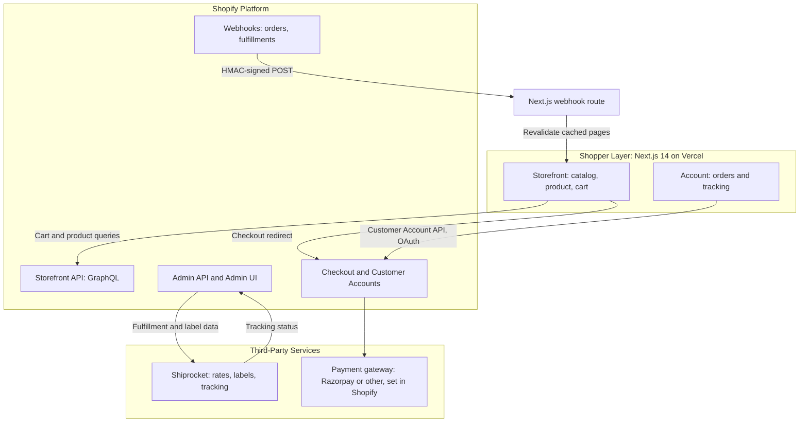

# Domestic E-Commerce Store: Shopify Storefront with Headless Next.js Frontend

A production-ready online store for selling physical products within a single country. Shoppers can check out with cards and digital wallets, create an account automatically at checkout, review past orders, and track shipments in real time. Store owners manage products, pricing, inventory, taxes, and shipping labels from a no-code admin dashboard.

**Platform:** Shopify (store engine, admin, checkout, customer accounts)
**Storefront:** Next.js 14 (App Router) with Tailwind CSS, deployed on Vercel
**Integrations:** Razorpay (or other gateway set in Shopify), Shiprocket (domestic shipping and labels), Shopify webhooks (order status updates)


---

## 1. Requirements Coverage

| Client requirement | How it is delivered | Verified by |
| :--- | :--- | :--- |
| Secure checkout with major cards and digital wallets | Shopify Checkout (PCI compliant) with cards, UPI, and wallets enabled through the payment provider configured in Shopify Admin | Test order with a card and a wallet (see Section 10) |
| Automatic account creation | Customers are created when they check out. Account invitation email sent by Shopify. Login through Shopify Customer Accounts | Test order creates a new customer record |
| Review past purchases and track orders in real time | `/account` pages read orders through the Customer Account API. Tracking updates arrive through Shopify fulfillment webhooks and Shiprocket tracking links | Order moved through each status and showed correctly on the account page |
| Domestic shipping rate calculation | Shopify shipping zones and weight-based rates for the client's country. Shiprocket for courier rates where needed | Rate shown at checkout matches the configured zone |
| Tax configuration (GST) | Shopify tax settings with GST rates per product category. Tax shown on checkout and invoices | Test order shows correct GST breakdown |
| Responsive design (desktop and mobile) | Tailwind CSS, mobile-first layouts | Manual test on [device list] |
| Product catalog setup | Products, variants, collections, and images managed in Shopify Admin | Catalog imported and visible on storefront |
| No-code admin dashboard | Shopify Admin (add products, upload photos, edit prices, update stock) | Client completes a task from the admin guide |
| Shipping label printing | Shiprocket generates a printable domestic label from the Shopify order | Label printed with correct address, weight, and postage |
| SEO friendly | Server-rendered product pages, JSON-LD product schema, dynamic metadata, `sitemap.xml`, `robots.txt` | Lighthouse SEO score [target 90+] |
| Handles traffic spikes | Shopify's hosted checkout and infrastructure. Next.js static caching with on-demand revalidation | Load test results: [attach report] |
| Admin guide | `docs/Admin_Guide.pdf` and a short screen-recorded walkthrough | Delivered at handover |

---

## 2. Architecture



### Why Shopify with a Next.js storefront?

- **Shopify handles what it is best at:** payments, PCI compliance, inventory, tax, order records, customer accounts, and the admin interface. The client does not need to build or maintain these.
- **Next.js handles the shopper experience:** fast, SEO-optimized pages with a custom design.
- **Trade-off:** Shopify carries a recurring plan fee paid by the client. This is included in the proposal (see Section 12).

### Alternative considered

A fully custom build (Next.js, Python FastAPI, PostgreSQL, custom admin) was considered. It removes the Shopify fee but adds build time, ongoing maintenance, and security responsibility for payments and inventory. It was not selected because the client expects Shopify. Why? Traditional WooCommerce (PHP/WordPress) crashes under high traffic spikes

---

## 3. Tech Stack

| Layer | Technology |
| :--- | :--- |
| Storefront | Next.js 14 (App Router), React, TypeScript, Tailwind CSS |
| Commerce engine | Shopify (Basic or higher plan) |
| Storefront data | Shopify Storefront API (GraphQL) |
| Account and orders | Shopify Customer Account API (OAuth) |
| Server-side admin tasks | Shopify Admin API (server only, never exposed to browser) |
| Payments | Gateway configured in Shopify Admin (e.g., Razorpay). Cards, UPI, and wallets as enabled |
| Shipping and labels | Shiprocket (Shopify app integration) |
| Hosting | Vercel (storefront), Shopify (store backend) |
| Analytics | [Google Analytics 4 or leave blank] |

---

## 4. Repository Structure

```
domestic-store/
├── frontend/                          # Next.js 14 storefront
│   ├── src/app/(storefront)/          # Home, collections, product pages, cart
│   ├── src/app/(account)/account/     # Login, order history, order tracking
│   ├── src/app/api/webhooks/shopify/  # HMAC-verified webhook receiver
│   ├── src/app/api/revalidate/        # On-demand cache revalidation
│   ├── src/app/sitemap.ts             # Dynamic sitemap.xml
│   ├── src/app/robots.ts              # robots.txt
│   ├── src/lib/shopify/               # Storefront API client and GraphQL queries
│   ├── src/lib/shopify/webhooks.ts    # HMAC verification helper
│   ├── src/components/seo/            # Metadata, OpenGraph, JSON-LD product schema
│   └── src/components/                # UI components
├── docs/
│   ├── Admin_Guide.pdf                # Step-by-step guide for the store owner
│   └── /Handover_Video.md              # Link to recorded walkthrough
├── .env.example                       # Required environment variables (no secrets)
└── README.md
```

---

## 5. Setup

### Prerequisites

- Node.js 20 or later
- A Shopify store on a paid plan, with a custom app created in Shopify Admin
- Shiprocket account, connected to Shopify
- A payment gateway enabled in Shopify (see Section 6)

### Environment variables

Copy `.env.example` to `.env.local` in `frontend/`:

```bash
# Public (safe to expose to the browser)
NEXT_PUBLIC_SITE_URL=https://[your-domain.com]
NEXT_PUBLIC_SHOPIFY_STORE_DOMAIN=[store-name].myshopify.com
NEXT_PUBLIC_SHOPIFY_STOREFRONT_TOKEN=[storefront-access-token]
NEXT_PUBLIC_SHOPIFY_CUSTOMER_ACCOUNT_CLIENT_ID=[client-id]

# Server only (never prefix with NEXT_PUBLIC_)
SHOPIFY_ADMIN_API_TOKEN=[admin-api-token]
SHOPIFY_WEBHOOK_SECRET=[webhook-signing-secret]
REVALIDATE_SECRET=[long-random-string]
```

### Run locally

```bash
cd frontend
npm install
npm run dev
```

Open `http://localhost:3000`.

### Build

```bash
npm run build
npm run start
```

---

## 6. Payments Configuration

Payments are configured in **Shopify Admin > Settings > Payments**, not in this codebase. Because checkout is hosted by Shopify, no card data touches the storefront.

1. Set up the chosen gateway (for example, Razorpay). Confirm that it supports the client's business type and domestic cards, UPI, and wallets.
2. Confirm whether **Shopify Payments** is available for the client's country and business. If it is not available, use a third-party gateway from Shopify's supported list.
3. Enable the payment methods the client wants (cards, UPI, Apple Pay, Google Pay, wallets).
4. Run a **test mode** order with a test card and a test wallet before going live.
5. Switch to live mode and place one small real order, then refund it.

> For domestic sales in India, card and UPI gateways generally offer better coverage.

---

## 7. Shipping and Tax Configuration

### Shipping zones (Shopify Admin > Settings > Shipping and delivery)

- Create one zone for the client's country. Do not enable international zones (client sells domestically only).
- Add weight-based rates or flat rates per zone.
- Connect Shiprocket to pull live courier rates where the client prefers real carrier pricing.

### Tax (Shopify Admin > Settings > Taxes and duties)

- Enable tax collection for the domestic market.
- Set GST rates per product category (for example, 5%, 12%, 18%) based on the client's product list.
- Confirm with the client's accountant that the rates and invoice format meet GST requirements. This is a configuration task, not tax advice.

---

## 8. Shipping Labels

1. The store owner opens a paid order in Shopify Admin.
2. The order is sent to Shiprocket (automatically or with one click, depending on setup).
3. Shiprocket generates a printable courier label containing the recipient address, weight, barcode, and postage.
4. Label is printed from Shiprocket and attached to the parcel.

Label contents are controlled by Shiprocket. Confirm a test label prints correctly on the client's printer before handover.

---

## 9. Order Status and Tracking

Order status moves through these stages:

`Order Confirmed → Packed → Shipped → Out for Delivery → Delivered`

**How it works:**

- Shopify records each stage as an order or fulfillment event.
- Shopify sends webhooks (`orders/paid`, `fulfillments/create`, `fulfillments/update`) to `/api/webhooks/shopify`.
- The webhook handler verifies the HMAC signature using `SHOPIFY_WEBHOOK_SECRET`, rejects unsigned requests, and revalidates the affected pages.
- Customers see the current status on `/account/orders/[id]`. Shiprocket tracking links are shown when available.

**Customer notifications:** Shopify sends order confirmation and shipping emails. Email templates are edited in Shopify Admin under Settings > Notifications.

---

## 10. Acceptance Testing

Complete these checks before handover. Mark each one only after it has been tested.

- [ ] Test order with a **card** completes successfully
- [ ] Test order with a **digital wallet** completes successfully
- [ ] Test order with **UPI** completes successfully (if enabled)
- [ ] A customer account is created automatically after checkout
- [ ] Account invitation email is received
- [ ] Customer logs in and sees the order in order history
- [ ] Order status changes are visible to the customer (Confirmed → Packed → Shipped → Out for Delivery → Delivered)
- [ ] Shipping label prints with correct domestic address and postage
- [ ] Shipping rate at checkout matches the configured zone
- [ ] GST appears correctly on the order and invoice
- [ ] Storefront tested on desktop Chrome, Safari, and Firefox
- [ ] Storefront tested on Android and iOS (real devices or emulator)
- [ ] Lighthouse scores: Performance [target], SEO [target], Accessibility [target]
- [ ] `sitemap.xml` and `robots.txt` load correctly
- [ ] Load test with [number] concurrent users: results attached
- [ ] Admin guide walkthrough completed with client

---

## 11. Deployment

### Storefront (Vercel)

1. Push the repository to GitHub.
2. Import the `frontend/` folder in Vercel.
3. Add all environment variables from Section 5 in Vercel project settings.
4. Connect the custom domain and enable HTTPS.
5. Register the webhook URL in Shopify Admin: `https://[your-domain.com]/api/webhooks/shopify`.

### Store

- Shopify store plan and domain are managed by the client's Shopify account.

---

## 12. Handover Checklist

- [ ] Client has admin access to Shopify, Shiprocket, and the payment gateway
- [ ] Admin guide (`docs/Admin_Guide.pdf`) delivered
- [ ] walkthrough delivered (`docs/Handover_Video.md`)
- [ ] Environment variables handed over securely (not in the repository)
- [ ] Recurring costs explained to the client: Shopify plan, Shiprocket fees, gateway fees, domain, Vercel (if on paid plan)

---

## 13. Assumptions and Out of Scope

- Client sells physical goods shipped within one country only.
- Client provides branding assets, product photos, and copy.
- Shopify store plan fees and third-party app fees are paid by the client.
- Ongoing content entry (products, photos, pricing) is handled by the client after handover.
- Custom features beyond the requirements above are not included unless agreed in writing.

---

## 14. Support

contact: Rajkumar, rajkelango.rk@gmail.com

Developer portfolio: https://my-portfolio-website-navy-gamma.vercel.app/
